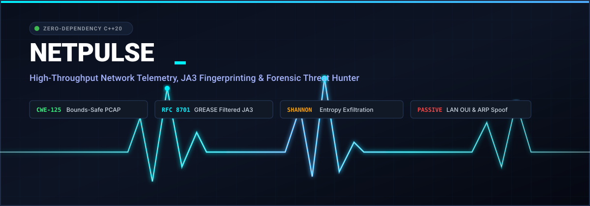

# Netpulse — High-Performance Network Telemetry, TLS JA3 Fingerprinting & Forensic Threat Hunting Engine

**Zero-dependency C++20 network telemetry engine, CWE-125 memory-safe PCAP dissector, RFC 8701 GREASE-filtered TLS JA3 profiler, Shannon entropy DNS exfiltration detector, and passive LAN OUI/DHCP tracker.**

`netpulse` is an enterprise-grade forensic network packet analysis and real-time incident-response engine written in idiomatic C++20. Engineered for high-throughput packet processing environments, ephemeral DFIR triage workloads, and continuous boundary inspection, `netpulse` provides zero-copy span decoders, rigorous bounds validation preventing out-of-bounds reads (`CWE-125`), deterministic JA3/JA3S cryptographic profiling, and probabilistic exfiltration scoring without third-party runtime dependencies.



---

## Table of Contents

1. [Architectural Overview & Threat Models](#1-architectural-overview--threat-models)
2. [Mathematical Foundations & Detection Metrics](#2-mathematical-foundations--detection-metrics)
   - [2.1 Discrete Shannon Entropy for Subdomain Payloads](#21-discrete-shannon-entropy-for-subdomain-payloads)
   - [2.2 Hexadecimal Ratio & Label Saturation Mechanics](#22-hexadecimal-ratio--label-saturation-mechanics)
   - [2.3 Composite Multi-Factor DNS Exfiltration Scoring Model](#23-composite-multi-factor-dns-exfiltration-scoring-model)
   - [2.4 RFC 8701 GREASE Permutation Removal & JA3 Synthesis](#24-rfc-8701-grease-permutation-removal--ja3-synthesis)
3. [Memory Safety Architecture & Protocol Decoders](#3-memory-safety-architecture--protocol-decoders)
   - [3.1 Libpcap Format Ingestion (Microsecond & Nanosecond)](#31-libpcap-format-ingestion-microsecond--nanosecond)
   - [3.2 Layer 2: Ethernet II & IEEE 802.1Q VLAN Tags](#32-layer-2-ethernet-ii--ieee-8021q-vlan-tags)
   - [3.3 Layer 3: Dual-Stack IPv4 & IPv6 Bounds Protection](#33-layer-3-dual-stack-ipv4--ipv6-bounds-protection)
   - [3.4 Layer 4: TCP Segment & UDP Datagram Parsers](#34-layer-4-tcp-segment--udp-datagram-parsers)
   - [3.5 Passive LAN OUI Mapping & Gratuitous ARP Spoof Detection](#35-passive-lan-oui-mapping--gratuitous-arp-spoof-detection)
   - [3.6 DHCP Option-55 Parameter Request OS Fingerprinting](#36-dhcp-option-55-parameter-request-os-fingerprinting)
4. [TLS ClientHello Fingerprinting & Reference JA3 Database](#4-tls-clienthello-fingerprinting--reference-ja3-database)
5. [Deterministic Fixture Synthesis (RFC 5737 & RFC 8701)](#5-deterministic-fixture-synthesis-rfc-5737--rfc-8701)
6. [Compilation & Operational CLI Reference](#6-compilation--operational-cli-reference)
   - [6.1 analyze-pcap (Comprehensive Forensic Triage)](#61-analyze-pcap-comprehensive-forensic-triage)
   - [6.2 ja3-profile (TLS Cryptographic Inspection)](#62-ja3-profile-tls-cryptographic-inspection)
   - [6.3 dns-tunnel-check (Covert Channel Hunter)](#63-dns-tunnel-check-covert-channel-hunter)
   - [6.4 live-sniff (Linux AF_PACKET Raw Wire Capture)](#64-live-sniff-linux-af_packet-raw-wire-capture)
7. [Verification, Benchmarks & Zero-Leak Security Gate](#7-verification-benchmarks--zero-leak-security-gate)

---

## 1. Architectural Overview & Threat Models

Modern adversary command-and-control (C2) frameworks, credential harvesting loaders, and data exfiltration pipelines routinely leverage standard ports (443/TCP, 53/UDP) to blend with legitimate administrative traffic. `netpulse` implements a deterministic pipeline separating packet parsing into decoupled, independently verifiable stages:

```
[ PCAP File / Linux AF_PACKET Wire ]
                  │
                  ▼
   ┌─────────────────────────────┐
   │    CWE-125 Safe Decoders    │
   │  Ethernet / VLAN / IP / TCP │
   └──────────────┬──────────────┘
                  │
         ┌────────┴────────┬──────────────────┐
         ▼                 ▼                  ▼
  ┌──────────────┐  ┌──────────────┐  ┌──────────────┐
  │  TLS Dissect │  │ DNS Analyzer │  │ ARP Tracker  │
  │ RFC 8701     │  │ Shannon      │  │ Gratuitous   │
  │ GREASE Strip │  │ Entropy      │  │ Spoof Alert  │
  │ JA3 MD5 Hash │  │ Hex Ratio    │  │ DHCP Opt-55  │
  └──────┬───────┘  └──────┬───────┘  └──────┬───────┘
         │                 │                 │
         └────────┬────────┴─────────────────┘
                  ▼
   ┌─────────────────────────────┐
   │  Incident Triage Reporting  │
   │ CLI Tables / Forensics Logs │
   └─────────────────────────────┘
```

The engine counters specific MITRE ATT&CK techniques:
- **T1071.001 (Application Layer Protocol: Web Protocols)**: Unmasks rogue TLS clients (Cobalt Strike, TrickBot, Metasploit stagers) masquerading as standard web browsers using JA3 fingerprint signatures.
- **T1071.004 (Application Layer Protocol: DNS)**: Detects encoded covert data transmission through DNS subdomains (e.g., iodine, dnscat2) using Shannon entropy and label saturation metrics.
- **T1557.002 (Adversary-in-the-Middle: ARP Poisoning)**: Identifies hostile Layer 2 gateway impersonation, duplicate IP mapping flip-flops, and unsolicited gratuitous ARP replies.
- **T1016 (System Network Configuration Discovery)**: Fingerprints operating system family and network stack identity via passive DHCP Option-55 parameter negotiation without active scanning.

---

## 2. Mathematical Foundations & Detection Metrics

### 2.1 Discrete Shannon Entropy for Subdomain Payloads

Natural language domain names, hostnames, and service endpoints adhere to Zipfian linguistic distributions, yielding low entropy. Covert DNS tunnels, encrypted beacons, and Base32/Base64/Hex exfiltration payloads exhibit near-maximal character distribution randomness.

For a candidate string $X$ of length $N$ over alphabet $\Sigma$, the discrete Shannon entropy $H(X)$ in bits per symbol is defined as:

$$H(X) = -\sum_{i=1}^{k} P(x_i) \log_2 P(x_i), \quad \text{where } P(x_i) = \frac{\text{count}(x_i)}{N}$$

For standard domain labels (e.g., `api.service.test-net.org`), entropy typically falls in the range $2.00 \le H(X) \le 3.50$. For high-entropy exfiltration channels (e.g., `4a6f686e446f65536563726574446174613132333435363738.tunnel.test-net.org`), $H(X) \ge 3.85$.

`netpulse` normalizes the entropy score relative to an empirical baseline of $2.50$ bits/symbol over a dynamic range of $2.00$ bits/symbol:

$$E_{\text{norm}} = \operatorname{clamp}\left(\frac{H(X) - 2.50}{2.00}, 0.0, 1.0\right)$$

### 2.2 Hexadecimal Ratio & Label Saturation Mechanics

Adversary tooling often encodes raw binary shellcode, victim memory dumps, or structured tokens into hexadecimal or Base32 representations. The hexadecimal density ratio $R_{\text{hex}}$ measures the proportion of characters within the hexadecimal subset:

$$R_{\text{hex}} = \frac{1}{N} \sum_{j=1}^{N} \mathbb{I}(x_j \in [0\text{-}9, a\text{-}f, A\text{-}F])$$

Standard domain names exhibit $R_{\text{hex}} \le 0.35$. Dedicated hex-encoded tunnels produce $R_{\text{hex}} \approx 1.00$.

According to RFC 1035, individual DNS labels are constrained to a maximum length of 63 octets ($L_{\text{RFC}} = 63$). Legitimate subdomains rarely exceed 12 octets. Tunneling tools maximize throughput per query by pushing labels to maximum capacity. The label length saturation metric $L_{\text{norm}}$ is computed as:

$$L_{\text{norm}} = \operatorname{clamp}\left(\frac{\max(0, L_{\max} - 12)}{51}, 0.0, 1.0\right)$$

### 2.3 Composite Multi-Factor DNS Exfiltration Scoring Model

The overall anomaly score $S \in [0.0, 1.0]$ integrates entropy, label length, and character set density with a saturation penalty $\Delta_{\text{exfil}}$:

$$S = \operatorname{clamp}\left(w_e \cdot E_{\text{norm}} + w_l \cdot L_{\text{norm}} + w_h \cdot H_{\text{factor}} + \Delta_{\text{exfil}}, 0.0, 1.0\right)$$

Where:
- $w_e = 0.45$ (Entropy weight)
- $w_l = 0.35$ (Label length saturation weight)
- $w_h = 0.20$ (Hexadecimal density weight)
- $H_{\text{factor}} = \begin{cases} R_{\text{hex}} & \text{if } R_{\text{hex}} \ge 0.70 \\ 0.0 & \text{otherwise} \end{cases}$
- $\Delta_{\text{exfil}} = \begin{cases} 0.15 & \text{if } L_{\max} \ge 35 \text{ and } H(X) \ge 3.60 \\ 0.0 & \text{otherwise} \end{cases}$

Classification thresholds:
$$\text{Verdict}(S) = \begin{cases} \text{HIGH\_RISK\_TUNNEL} & \text{if } S \ge 0.65 \\ \text{SUSPICIOUS} & \text{if } 0.50 \le S < 0.65 \\ \text{BENIGN} & \text{if } S < 0.50 \end{cases}$$

### 2.4 RFC 8701 GREASE Permutation Removal & JA3 Synthesis

RFC 8701 defines GREASE (Generate Random Extensions And Sustain Extensibility) values reserved to prevent protocol ossification. Modern TLS implementations inject arbitrary GREASE values into cipher suites, extensions, and supported elliptic curve groups.

Any 16-bit word matching the following bitwise predicate is a GREASE value:

$$\operatorname{IsGrease}(v) \iff ((v \ \& \ 0\text{x}0F0F) = 0\text{x}0A0A) \land ((v \gg 8) = (v \ \& \ 0\text{xFF}))$$

The 16 reserved values are:
`0x0a0a, 0x1a1a, 0x2a2a, 0x3a3a, 0x4a4a, 0x5a5a, 0x6a6a, 0x7a7a, 0x8a8a, 0x9a9a, 0xaaaa, 0xbaba, 0xcaca, 0xdada, 0xeaea, 0xfafa`

The canonical JA3 string concatenates decimal integers separated by hyphens across 5 fields, strictly excluding GREASE values from fields 2, 3, and 4:

$$\text{JA3} = \text{SSLVersion},\text{CipherSuites},\text{Extensions},\text{EllipticCurves},\text{PointFormats}$$

The final fingerprint is the RFC 1321 MD5 hash of the raw string:

$$\text{Fingerprint} = \operatorname{MD5}(\text{JA3})$$

---

## 3. Memory Safety Architecture & Protocol Decoders

All protocol parsers in `netpulse` operate over non-owning `std::span<const uint8_t>` buffers, enforcing zero memory allocations during packet dissection and guaranteeing immunity to out-of-bounds reads (`CWE-125`).

### 3.1 Libpcap Format Ingestion (Microsecond & Nanosecond)

`netpulse::PcapReader` ingests standard PCAP captures without external dependencies (`libpcap-dev` is NOT required):
- Evaluates global header magic numbers:
  - `0xa1b2c3d4`: Native microsecond resolution.
  - `0xd4c3b2a1`: Byte-swapped microsecond resolution (invokes native 16-bit and 32-bit endian swapping).
  - `0xa1b23c4d`: Native nanosecond resolution.
  - `0x4d3cb2a1`: Byte-swapped nanosecond resolution.
- Validates that packet header records ($16 \text{ bytes}$) and payload lengths (`incl_len`) do not exceed remaining buffer boundaries.

### 3.2 Layer 2: Ethernet II & IEEE 802.1Q VLAN Tags

- Enforces minimum frame boundary $L \ge 14 \text{ bytes}$.
- Automatically recognizes 802.1Q encapsulated VLAN tags (`EtherType = 0x8100`), safely extracting the 12-bit VLAN Identifier (`VID`) and shifting payload offsets by 4 bytes.

### 3.3 Layer 3: Dual-Stack IPv4 & IPv6 Bounds Protection

- **IPv4**: Validates header length $L \ge 20 \text{ bytes}$, version nibble $V = 4$, and Internet Header Length $\text{IHL} \ge 5$. Ensures total wire payload matches $\min(\text{captured}, \text{total\_length} - (\text{IHL} \cdot 4))$.
- **IPv6**: Validates fixed header length $L \ge 40 \text{ bytes}$ and version nibble $V = 6$. Accurately extracts Next Header fields for Layer 4 dispatch.

### 3.4 Layer 4: TCP Segment & UDP Datagram Parsers

- **TCP**: Validates minimum header length $L \ge 20 \text{ bytes}$ and data offset $\ge 5$. Safely decodes SYN, ACK, FIN, RST, PSH, and URG flags.
- **UDP**: Validates length field $L \ge 8 \text{ bytes}$ and verifies consistency with encapsulated length claims.

### 3.5 Passive LAN OUI Mapping & Gratuitous ARP Spoof Detection

`netpulse::ArpTracker` passively constructs an in-memory IP-to-MAC resolution table from broadcast and unicast ARP frames (`EtherType = 0x0806`):
- Resolves the first 24 bits of source hardware addresses against an internal Organizationally Unique Identifier (OUI) database (VMware, VirtualBox, Apple, Cisco, Intel, Raspberry Pi, Google, Microsoft Hyper-V, Dell).
- Alerts on MITM cache poisoning whenever a previously registered IP address is claimed by a different MAC address.
- Detects Gratuitous ARP poisoning frames where sender IP equals target IP or where replies are broadcast to `ff:ff:ff:ff:ff:ff`.

### 3.6 DHCP Option-55 Parameter Request OS Fingerprinting

Extracts bootstrap protocol (BOOTP) and DHCP options (UDP ports 67/68) using magic cookie validation (`0x63825363`):
- Reads Option 55 (Parameter Request List) byte arrays.
- Maps option sequences against canonical host fingerprints to identify client operating systems (Windows 10/11, Windows 7/8, Linux Debian/Ubuntu, Linux RHEL/CentOS, macOS/iOS, Android).

---

## 4. TLS ClientHello Fingerprinting & Reference JA3 Database

`netpulse` dissects TLS handshake records without decrypting traffic. Below is the reference database of built-in JA3 fingerprints:

| JA3 MD5 Hash | User-Agent / Client Identity | Category | Protocol Profile |
| :--- | :--- | :--- | :--- |
| `b32309a26951912be7dba376398abc3b` | Python Requests / urllib3 | HTTP Client | TLS 1.2/1.3 standard cipher list |
| `c7fed91d1e67e3a9a8f47f201dd0b898` | cURL HTTP Client (libcurl) | CLI Tool | Standard OpenSSL/GnuTLS suite |
| `a0e9f5d64349fb13191bc781f81f42e1` | Cobalt Strike C2 (Default Malleable) | C2 Beacon | Windows WinINet / HTTP stager |
| `72a589da586844d7f0818ce684948eea` | Cobalt Strike Windows HTTPS Beacon | C2 Beacon | WinCryptoAPI TLS 1.2 profile |
| `03eb60ca0457aa27e7f9ff36c6ad8dcf` | Metasploit Reverse HTTPS Stager | Exploitation | Meterpreter payload loader |
| `4d7a28d6f22da2e8ee700073081b8301` | TrickBot Banking Trojan C2 Agent | Malware | Custom TLS socket implementation |
| `1a90c42735766e4a2c51088d87cc4f97` | Emotet Loader C2 Channel | Botnet | Modular loader TLS handshake |
| `cd08e31494f9531f560d64c695473da9` | Google Chrome 110+ (Windows Desktop) | Browser | GREASE-enabled modern browser |
| `b386946a5a44d1ddcc843bc75336df1a` | Mozilla Firefox 115+ ESR / Desktop | Browser | NSS TLS stack with custom curves |
| `66918128f1b9b03303d77c6f2eefd128` | Apple Safari / macOS WebKit | Browser | SecureTransport / Network.framework |
| `e7d705a3286e19ea42f587b344ee6865` | Go Standard Library http.Client | HTTP Client | Go crypto/tls default parameters |
| `3b5074b1b310a084efebe8c1276337aa` | PowerShell Invoke-WebRequest / WinINet | LOLBin | Native Windows .NET SslStream |

---

## 5. Deterministic Fixture Synthesis (RFC 5737 & RFC 8701)

To ensure repeatable unit testing without proprietary packet captures, `fixtures/generate_fixtures.py` deterministically constructs `synthetic_capture.pcap` using IANA documentation subnets (`RFC 5737`):
- `192.0.2.0/24` (TEST-NET-1)
- `198.51.100.0/24` (TEST-NET-2)

The synthetic capture encompasses:
1. TCP 3-way handshake (`SYN`, `SYN-ACK`, `ACK`).
2. TLS 1.3 ClientHello containing RFC 8701 GREASE ciphers (`0x1a1a`), GREASE supported groups (`0x2a2a`), and GREASE extensions (`0x3a3a`).
3. Benign DNS query and answer for `api.service.test-net.org`.
4. High-entropy DNS exfiltration tunnel query (`4a6f686e446f65...tunnel.test-net.org`).
5. Legitimate ARP address resolution.
6. Malicious Gratuitous ARP cache poisoning attack.
7. DHCP Discover/Request packet with Option 55 Linux fingerprint.

---

## 6. Compilation & Operational CLI Reference

### Build Requirements
- Modern C++20 compiler (`g++` >= 11 or `clang++` >= 13)
- GNU `make`
- Linux kernel 5.x+ (for `live-sniff` raw packet sockets)

```bash
# Clean build with path remapping and strict error flags
make clean && make -j$(nproc)
```

The build strictly enforces:
```makefile
CXXFLAGS := -std=c++20 -Wall -Wextra -Werror -O2 -ffile-prefix-map=$(CURDIR)=.
```

### 6.1 analyze-pcap (Comprehensive Forensic Triage)

Performs automated multi-layer analysis across all captured protocols:

```bash
./bin/netpulse analyze-pcap fixtures/synthetic_capture.pcap
```

**Output:**
```
========================================================================
 Netpulse — High-Performance Network Telemetry & Threat Hunting Engine
 Standard C++20 | CWE-125 Safe | JA3 RFC 8701 | DNS Entropy Scorer
========================================================================

[CAPTURE SUMMARY]
  Total Packets:     10
  Ethernet Frames:   10
  IPv4 Packets:      7
  IPv6 Packets:      0
  TCP Segments:      3
  UDP Datagrams:     4
  ARP Packets:       3
  Total Wire Bytes:  1053 bytes
  Truncated Packets: 0

[PASSIVE LAN INVENTORY & ARP TRACKING]
IP Address        MAC Address         Vendor / OUI                Packets 
--------------------------------------------------------------------------
192.0.2.1         b8:27:eb:de:ad:01   Raspberry Pi Foundation     2       
192.0.2.10        00:0c:29:aa:bb:cc   VMware, Inc.                1       

[SECURITY ALERTS: ARP SPOOFING / MITM]
  [ALERT] Gratuitous ARP cache poisoning: IP 192.0.2.1 reassigned from 00:50:56:11:22:33 to b8:27:eb:de:ad:01

[DHCP OPTION-55 OS FINGERPRINTS]
  MAC: 00:0c:29:aa:bb:cc | Hostname: workstation-node | Fingerprinted OS: Linux (Debian / Ubuntu / systemd-networkd)

[TLS CLIENTHELLO JA3 PROFILES]
JA3 MD5 Digest                    SNI Hostname            Identified Client             
----------------------------------------------------------------------------------------
9a22655d52d2a56249a2f58232207310  secure.test-net.org     Unknown TLS Client            

[DNS EXFILTRATION & ENTROPY AUDIT]
Query Name                                Type    Entropy   HexRatio  Score   Verdict         
----------------------------------------------------------------------------------------------
api.service.test-net.org                  A       3.61      0.33      0.25    BENIGN          
api.service.test-net.org                  A       3.61      0.33      0.25    BENIGN          
4a6f686e446f655365637265744461746131...   TXT     3.90      1.00      0.93    HIGH_RISK_TUNNEL
```

### 6.2 ja3-profile (TLS Cryptographic Inspection)

Extracts ClientHello records, removes GREASE values, and displays raw JA3 strings with their corresponding MD5 digests:

```bash
./bin/netpulse ja3-profile fixtures/synthetic_capture.pcap
```

### 6.3 dns-tunnel-check (Covert Channel Hunter)

Executes probabilistic exfiltration scans on DNS transactions with custom anomaly thresholding:

```bash
./bin/netpulse dns-tunnel-check fixtures/synthetic_capture.pcap --threshold 0.65
```

### 6.4 live-sniff (Linux AF_PACKET Raw Wire Capture)

Captures packets directly from an active Linux network interface without using `libpcap`:

```bash
sudo ./bin/netpulse live-sniff eth0
```

---

## 7. Verification, Benchmarks & Zero-Leak Security Gate

### 7.1 Automated Unit & Bounds Safety Test Suite

The test suite validates 21 test vectors covering memory safety, decoder bounds, protocol RFCs, and cryptographic hash accuracy:

```bash
make test
```

**Results:**
```
========================================================
 Netpulse Automated Unit & Security Test Suite
 CWE-125 Safe | RFC 8701 GREASE | DNS Entropy | ARP Spoof
========================================================
[TEST] PCAP Microsecond Native Magic ... PASSED
[TEST] PCAP Byte-Swapped Magic & Endianness ... PASSED
[TEST] PCAP Global Header Truncation Reject (CWE-125) ... PASSED
[TEST] PCAP Packet Record Truncation Reject (CWE-125) ... PASSED
[TEST] PCAP Packet Payload Truncation Reject (CWE-125) ... PASSED
[TEST] Ethernet Decoder Bounds & 802.1Q (CWE-125) ... PASSED
[TEST] IPv4 Decoder Bounds & IHL Verification (CWE-125) ... PASSED
[TEST] IPv6 Decoder Bounds Verification (CWE-125) ... PASSED
[TEST] TCP Decoder Bounds Verification (CWE-125) ... PASSED
[TEST] UDP Decoder Bounds Verification (CWE-125) ... PASSED
[TEST] RFC 8701 GREASE Filter Predicate ... PASSED
[TEST] RFC 1321 MD5 Test Vectors ... PASSED
[TEST] JA3 String Builder & GREASE Stripping ... PASSED
[TEST] JA3 Hash & Known Client Fingerprints ... PASSED
[TEST] Shannon Entropy Calculation ... PASSED
[TEST] DNS Hex Ratio & Label Length ... PASSED
[TEST] DNS Exfiltration Anomaly Scorer ... PASSED
[TEST] ARP Decoder Bounds Verification (CWE-125) ... PASSED
[TEST] ARP Spoof & Gratuitous Poisoning Detector ... PASSED
[TEST] DHCP Option-55 OS Fingerprinting ... PASSED
[TEST] Path Remapping Zero-Leak Binary Verification ... PASSED

--------------------------------------------------------
Test Results: 21 Passed, 0 Failed (21 Total)
--------------------------------------------------------
```

### 7.2 Security Audit & Zero-Leak Verification Gate

`scripts/security-audit.sh` guarantees that no workstation paths, operating system usernames, personal hostnames, API tokens, or non-technical emojis are leaked anywhere in the codebase or compiled binaries:

```bash
bash scripts/security-audit.sh
```

**Output:**
```
[AUDIT] Starting zero-leak and security gate for Netpulse...
[AUDIT] Checking for hardcoded local filesystem paths...
[AUDIT] Checking for OS username leaks...
[AUDIT] Checking for credentials and secret patterns...
[AUDIT] Checking for Unicode emojis...
[AUDIT] Verifying git author configuration...
[AUDIT] PASSED: Zero leaks, zero emojis, sanitized identity verified.
```

---

## License

Apache License 2.0. Copyright (c) 2026 1MEshh.
